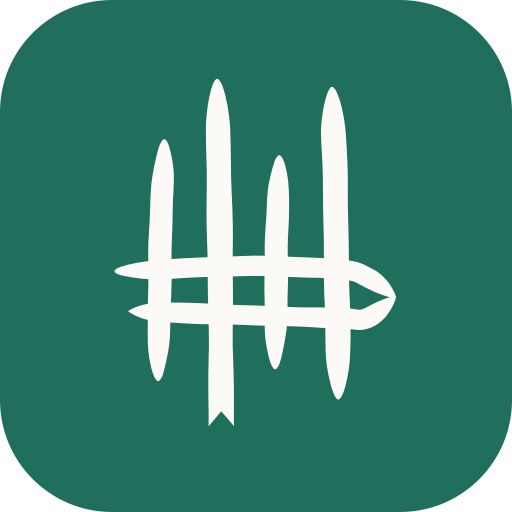

<picture>
  <source media="(prefers-color-scheme: dark)" srcset="packages/brand/logo/mark-dark.svg">
  
</picture>

# Read Later

A personal read-later app in the spirit of Pocket. Save an article while you browse; the app keeps the original link, a clean copy of the article, and a short summary written by Claude in the article's own language.

"Read Later" is a working name. The display name is the `APP_NAME` constant in [`packages/brand/index.js`](packages/brand/index.js); change it there and everything follows, the browser extension included. The logo, in [`packages/brand/logo`](packages/brand/logo), doesn't spell out the name, so it can stay.

This is **stage 1**: one owner, Google sign-in, saving from Chrome, Firefox, Safari and Android, and reading and comparing summaries in the web app. The later stages (an invite-only beta, a public launch, native apps) are described in [BRIEF.md](BRIEF.md); nothing here rules them out.

## What's in the repository

| Path | What it is |
| --- | --- |
| `apps/web` | The Next.js app: pages, sign-in, the save API, background jobs, the worker process |
| `apps/extension` | The browser extension for Chrome and Firefox (Manifest V3, plain TypeScript) |
| `apps/cron-worker` | A tiny Cloudflare Worker that runs leftover jobs every 5 minutes |
| `packages/brand` | The display name, and the logo every icon is drawn from |
| `docs/` | Setup guides, the Shortcut and extension guides, the server guide, and [decisions](docs/decisions.md) |
| `Dockerfile`, `docker-compose.yml` | The one-server setup |
| `.github/workflows/backup.yml` | The nightly database backup to Cloudflare R2 |

## How it works

1. **Saving.** The extension, the Shortcut, Android's Share menu and the web app's paste box all end up at `POST /api/save` (or the same code behind it). The request is authenticated with a personal access token, stored as a `pending` article together with a job, and answered right away with "Saved".
2. **Background jobs.** Jobs live in a Postgres table and are claimed with `FOR UPDATE SKIP LOCKED` by one function, `processJobs()`. A job downloads the page if only a URL was sent (http and https only, private addresses blocked, with time and size limits), extracts the article with Mozilla Readability, sanitizes it with DOMPurify, applies the paywall rules, then queues a summary for each model wanted. Failures are retried with backoff.
3. **Who runs the jobs.** On Vercel, `processJobs()` runs right after each save through Next.js `after()`, and the Cloudflare Worker calls `/api/jobs/run` every 5 minutes as a safety net. On a server, a worker process runs it in a loop.
4. **Summaries.** Each summary is one Claude API call that returns structured JSON: a one-sentence TL;DR, 3 to 5 key points and 1 to 3 suggested tags, all in the article's language. Every row stores its tokens, estimated cost and time, so the three models (Opus 5.5, Sonnet 5.5, Haiku 5.5) can be compared side by side.

## Local development (Windows, macOS or Linux)

You need **Node.js 24**, **pnpm** and Git. Docker is not needed.

1. Enable pnpm (it ships with Node) and install the dependencies:

   ```sh
   corepack enable
   pnpm install
   ```

   On Windows, `corepack enable` may need a terminal opened as administrator. If it fails, `npm install -g pnpm` works too.

2. Get a database. Either:
   - **a Neon branch** (easiest on Windows): copy `.env.example` to `.env` first (step 3), then create a `dev` branch of your Neon project and run `neon checkout dev`, which writes its connection strings into `.env` (see [docs/setup/neon.md](docs/setup/neon.md)). Without a `.env`, the Neon CLI writes `.env.local` instead, which the app reads ahead of `.env`. Or:
   - **a local Postgres 17**, with a database named `readlater`.

3. Copy `.env.example` to `.env` in the repository root and fill it in. For local work:
   - `APP_URL=http://localhost:3000`
   - `DATABASE_URL`: the connection string from step 2. With Neon, `neon checkout` has already written it, together with the direct string the migrations use, `DATABASE_URL_UNPOOLED`.
   - `BETTER_AUTH_SECRET` and `JOBS_SECRET`: random strings. In PowerShell or any terminal:
     `node -e "console.log(require('crypto').randomBytes(32).toString('base64'))"`
   - `GOOGLE_CLIENT_ID` and `GOOGLE_CLIENT_SECRET`: a Google OAuth client that allows `http://localhost:3000` (see [docs/setup/google-oauth.md](docs/setup/google-oauth.md)).
   - `ALLOWED_EMAILS`: your Google account's email.
   - `ANTHROPIC_API_KEY`: your Claude API key, or use the mock below.

4. Create the tables, then start the app:

   ```sh
   pnpm db:migrate
   pnpm dev
   ```

   Open <http://localhost:3000> and sign in with Google.

5. Create an access token in **Settings**, then try the [Chrome extension](docs/chrome-extension.md) with the server URL `http://localhost:3000`, or paste a link into the Inbox.

**Trying it without a Claude API key.** `pnpm --filter web mock-claude` starts a local stand-in for the Claude API that returns made-up summaries in the real streaming format. In `.env`, set `ANTHROPIC_BASE_URL=http://127.0.0.1:4010` and `ANTHROPIC_API_KEY=mock`, and restart `pnpm dev`. Everything else runs for real, and nothing is billed. Remove both lines to use Claude.

> Variables that are already set in your environment take precedence over `.env`. If something behaves as though your `.env` is ignored, check for a system-wide `ANTHROPIC_BASE_URL` or `DATABASE_URL`.

### Useful commands

| Command | What it does |
| --- | --- |
| `pnpm dev` | Runs the web app with hot reload (jobs run in `after()`) |
| `pnpm test` | Runs every package's tests |
| `pnpm typecheck` | Type-checks every package |
| `pnpm build` | Builds the web app for production (it downloads the reading fonts from Google Fonts, so it needs internet access) |
| `pnpm db:migrate` | Applies database migrations to `DATABASE_URL_UNPOOLED`, or to `DATABASE_URL` when that isn't set |
| `pnpm db:generate` | Creates a new migration after changing `apps/web/src/db/schema.ts` |
| `pnpm worker` | Runs the background worker loop (only needed on a server) |
| `pnpm extension:build` | Builds the extension for Chrome into `apps/extension/dist` and for Firefox into `apps/extension/dist-firefox` |
| `pnpm icons` | Redraws the app and extension icons from the logo in `packages/brand/logo` |

### Tests

`pnpm test` runs the unit tests (URL normalization, address blocking, paywall rules, extraction against saved sample pages, the job queue) and an integration test of save → job → summary with Claude mocked. They use [PGlite](https://pglite.dev), an in-memory Postgres, so they need no database.

One extra test proves that concurrent workers never take the same job, and it needs a real Postgres. It runs only when `TEST_DATABASE_URL` is set. **It drops and recreates every table in that database**, so point it at an empty throwaway database, never at your real one:

```sh
# macOS and Linux
TEST_DATABASE_URL=postgres://postgres@localhost:5432/readlater_test pnpm --filter web test
# Windows PowerShell
$env:TEST_DATABASE_URL="postgres://postgres@localhost:5432/readlater_test"; pnpm --filter web test
```

## Putting it online (the free setup)

Everything runs on free plans except the Claude API, which is paid per use. Each step below has its own guide. Each one involves creating an account or entering payment details, so do them yourself, in this order:

1. [Neon](docs/setup/neon.md): the Postgres database.
2. [Google OAuth client](docs/setup/google-oauth.md): Google sign-in.
3. [Anthropic API key](docs/setup/anthropic.md): summaries (paid per use).
4. [Vercel](docs/setup/vercel.md): hosts the web app.
5. [DNS on Cloudflare](docs/setup/dns.md): your own address, such as `read.example.com`.
6. [Cloudflare Worker cron](docs/setup/cloudflare-worker-cron.md): the safety net for background jobs.
7. [R2 backups](docs/setup/r2-backups.md): a nightly database backup.

Then connect your devices:

- [Chrome extension](docs/chrome-extension.md): toolbar button, keyboard shortcut and right-click "Save link".
- [Firefox extension](docs/firefox-extension.md): the same extension, for Firefox.
- [Safari Shortcut](docs/safari-shortcut.md): iPhone, iPad and Mac.
- **Android**: open the app in Chrome, choose **Add to Home screen → Install**, and it appears in the Share menu.

When the free plans stop being enough: [Move to one server](docs/move-to-server.md) (Docker Compose, about $14/month).

## Security notes

- Only the Google accounts in `ALLOWED_EMAILS` can sign in, and every database query is scoped to the signed-in user.
- Access tokens are stored only as SHA-256 hashes and shown once. Revoke them in Settings.
- Server-side downloads refuse private, loopback and link-local addresses, also after redirects, so the server can't be pointed at internal services.
- Saved HTML is sanitized before it is stored, and every page gets a nonce-based Content Security Policy, so even a script that got past the sanitizer would not run.
- A link to the Android share address on another website asks for confirmation instead of saving straight away.
- The app never gets around paywalls or logins. Pages that look truncated or ask for a login are marked "Preview only"; save them from your own signed-in browser to keep the full article.

## Decisions

Choices the brief didn't settle are recorded, with the reasoning, in [docs/decisions.md](docs/decisions.md).

## How this is being built

Read Later is built by Aaron Ding with Claude, in Claude Code.

- **Planning.** [BRIEF.md](BRIEF.md) sets what each stage builds. Where it leaves a choice open, Claude makes one and records it, with the reasoning, in [docs/decisions.md](docs/decisions.md).
- **Research.** The facts in the setup guides were checked by a separate Claude agent against the vendors' current documentation.
- **Review.** An independent Claude agent reviewed the code for security problems, and each finding was fixed with a test.
- **Code.** Claude writes the code, the tests and the docs. Aaron decides what ships.

This section is the credit for Claude's part, so commits carry no AI attribution lines.
